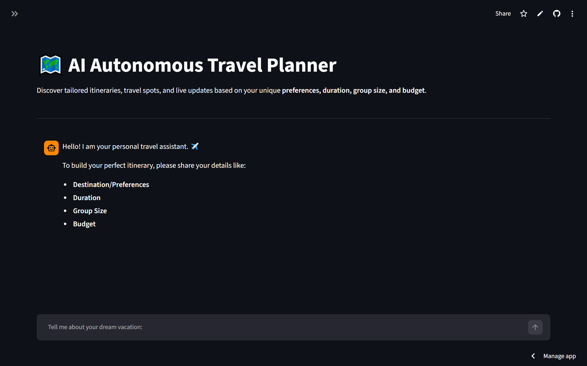

#  AI Travel Planner

## 🚀 About
Discover tailored itineraries, travel spots, and live updates based on your unique preferences, duration, group size, and budget.

## 🛠️ Tech Stack
- Python, Streamlit, LangChain, Groq API, Tavily API , Weather API

## ✨ Features
- Real-time web search via Tavily
- Real-time weather search via Weather Api
- AI-powered summarization
- Source citations

## 🔗 Live Demo
[https://ai-travel-planner-rw2vvr2ymkqeekmphzowxb.streamlit.app/]

## 📷 ScreenShots

## ⚙️ How to Run
1. Clone repo
2. `pip install -r requirements.txt`
3. Add `.env` with GROQ_API_KEY , TAVILY_API_KEY and WEATHER_API_KEY
4. `streamlit run ATP.py`